<div align="center">


# Matchly

**Match every rider with the right driver.**
A ride-hailing assignment problem solved with four algorithms, side by side.

[](https://manoj-kumar2277.github.io/algorithm-explorer/)
[](https://github.com/manoj-kumar2277/algorithm-explorer)


[Overview](#-overview) · [Screenshots](#-screenshots) · [Algorithms](#-the-four-algorithms) · [How it works](#-how-it-works) · [Run it](#-run-locally) · [Structure](#-project-structure) · [Team](#-team)

</div>

---

## 🚖 Overview

Ride apps like Uber, Ola and Rapido constantly face this question: *there are n free drivers and n waiting riders, so who should pick up whom?*

This is the **Assignment Problem**. Every driver is a different distance from every rider. We must give each rider exactly one driver, and each driver exactly one rider, so that the **total pickup distance is as small as possible**.

| | |
|---|---|
| **🎯 The problem** | Pair n drivers with n riders at the lowest total distance |
| **🌍 Why it matters** | Faster pickups for riders, less fuel and idle time for drivers. The same idea assigns delivery partners to orders and workers to tasks |
| **🧮 What Matchly computes** | A distance table from your coordinates, then the best pairing and total distance found by four algorithms, with a map and a comparison |

## 🖼️ Screenshots

<p align="center">
  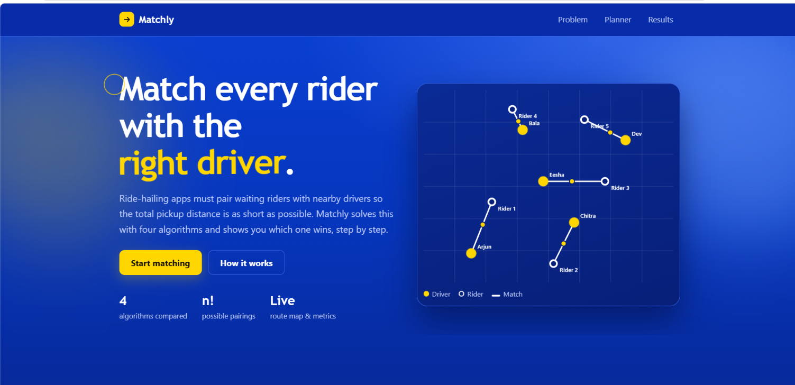
</p>

<table>
  <tr>
    <td width="50%">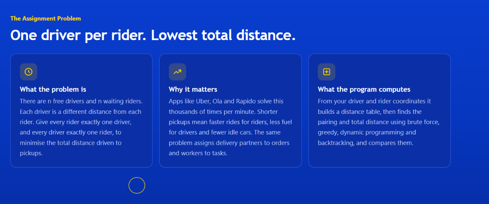<br><sub><b>Problem, importance and what is computed</b></sub></td>
    <td width="50%">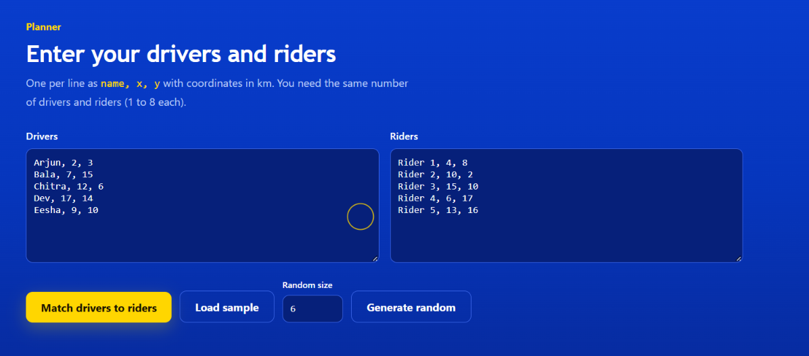<br><sub><b>Input form with sample data</b></sub></td>
  </tr>
  <tr>
    <td width="50%">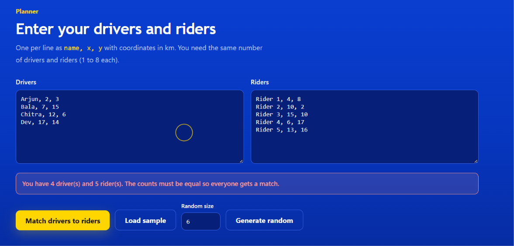<br><sub><b>Clear validation messages</b></sub></td>
    <td width="50%">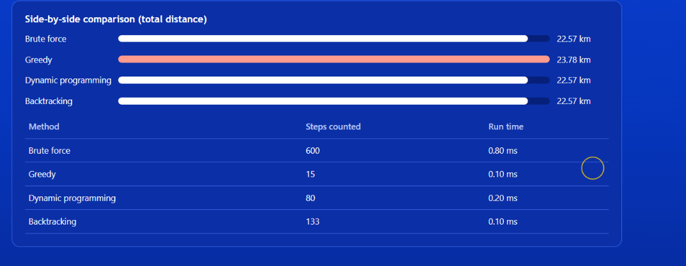<br><sub><b>Side-by-side comparison of all four methods</b></sub></td>
  </tr>
</table>

### One tab per algorithm

<table>
  <tr>
    <td width="50%">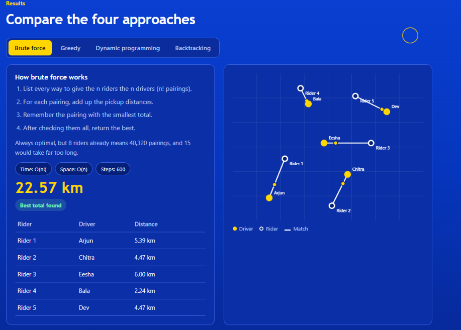<br><sub><b>1. Brute force</b></sub></td>
    <td width="50%">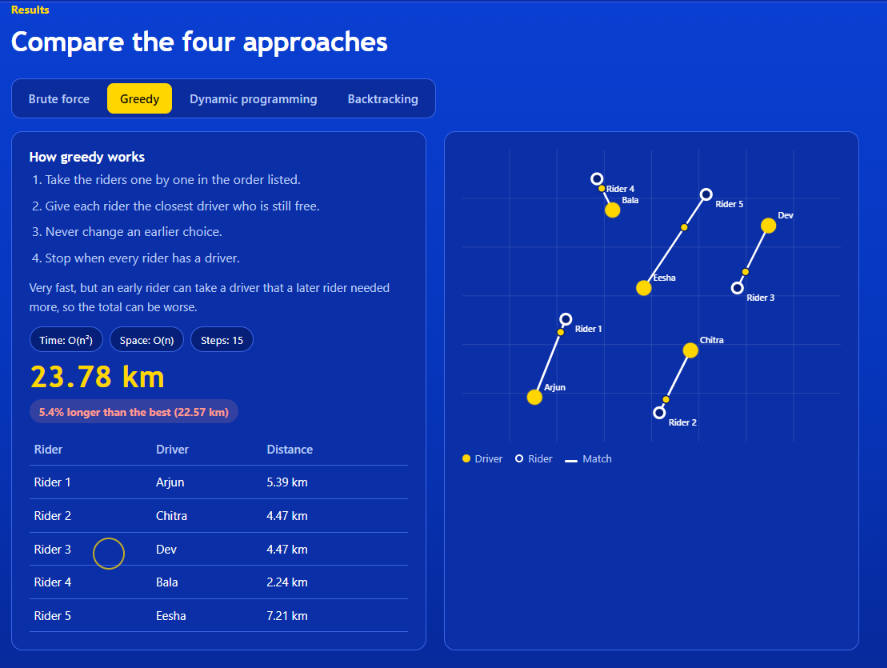<br><sub><b>2. Greedy</b></sub></td>
  </tr>
  <tr>
    <td width="50%">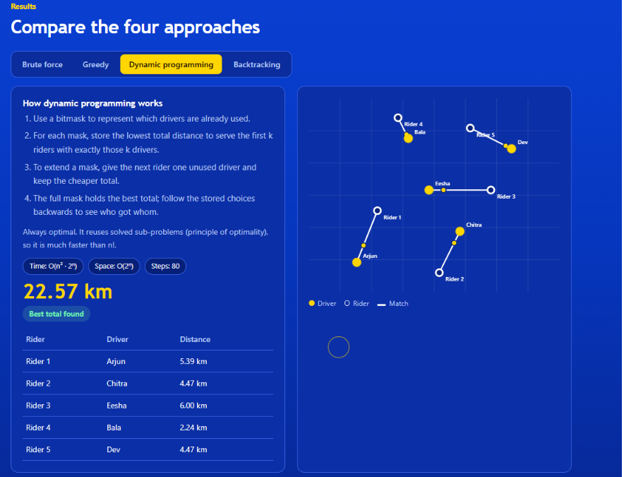<br><sub><b>3. Dynamic programming</b></sub></td>
    <td width="50%">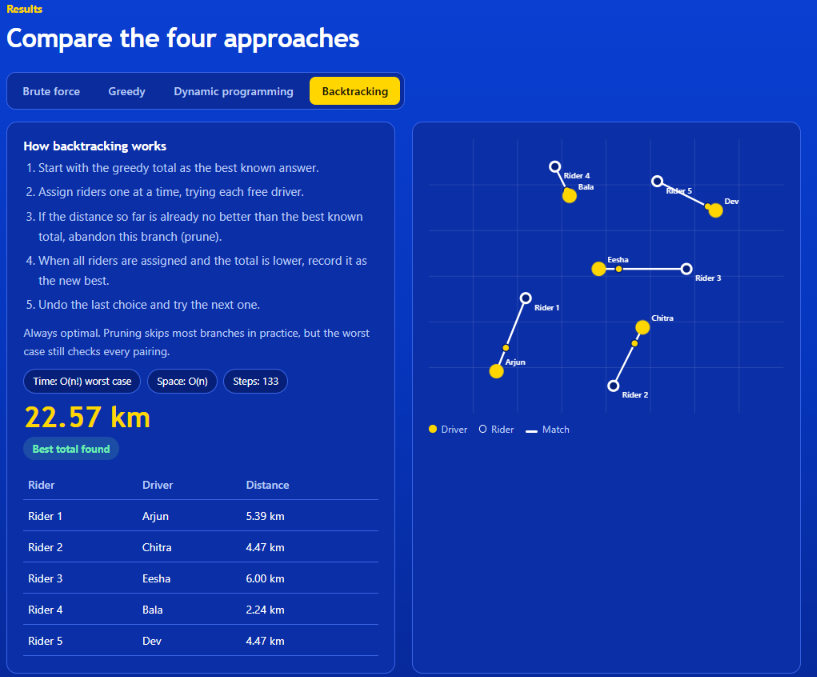<br><sub><b>4. Backtracking</b></sub></td>
  </tr>
</table>

### Works on every screen

The layout switches to a single column on phones. Screenshots below are from the live site on a real phone.

<table>
  <tr>
    <td width="25%">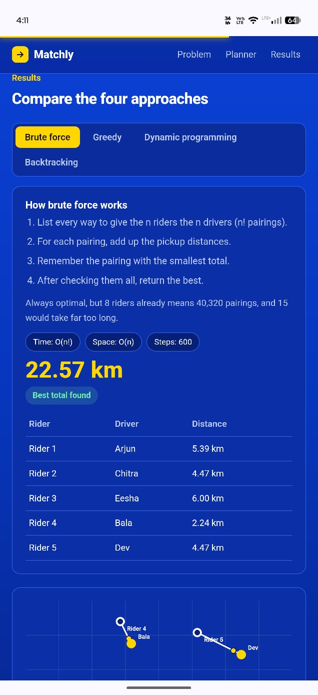<br><sub><b>Brute force</b></sub></td>
    <td width="25%">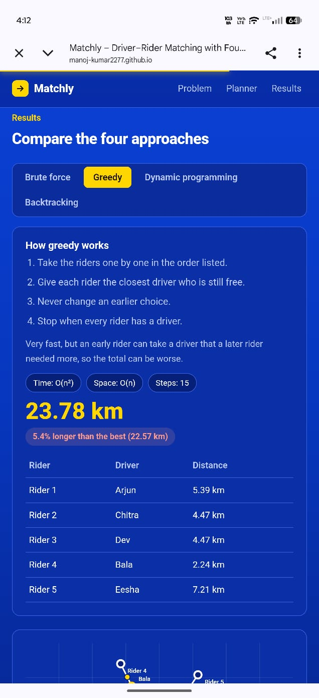<br><sub><b>Greedy</b></sub></td>
    <td width="25%">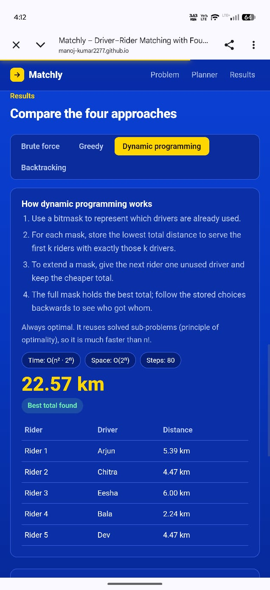<br><sub><b>Dynamic programming</b></sub></td>
    <td width="25%">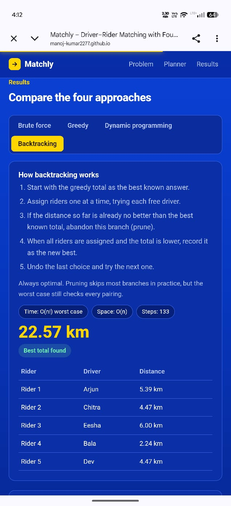<br><sub><b>Backtracking</b></sub></td>
  </tr>
</table>

## ✨ Features

- 🧭 **Clear intro:** what the problem is, why it matters and what is computed
- 📝 **Smart input form:** coordinates for drivers and riders, with sample data and a random generator
- ✅ **Validation:** wrong format, non-numbers, unequal counts and oversized input all show a clear message
- 🔀 **Four approaches, one click apart:** each tab explains the method step by step, shows time and space complexity and the result for *your* input
- 🗺️ **Live map:** matches are drawn as lines, with little cars driving along them
- 📊 **Comparison:** total distance, steps counted and run time for every method
- 🎨 **Polished UI:** custom cursor, scroll animations, responsive layout, reduced-motion support
- ⚡ **Zero dependencies:** plain HTML, CSS and JavaScript

## 🧠 The four algorithms

| # | Approach | File | Idea | Time | Space | Optimal? |
|---|---|---|---|---|---|---|
| 1 | **Brute force** | [`bruteForce.js`](js/bruteForce.js) | Try all n! pairings and keep the cheapest | `O(n!)` | `O(n)` | ✅ |
| 2 | **Greedy** | [`greedy.js`](js/greedy.js) | Each rider takes the nearest free driver | `O(n²)` | `O(n)` | ❌ not always |
| 3 | **Dynamic programming** | [`dynamicProgramming.js`](js/dynamicProgramming.js) | Bitmask of used drivers, reuse the best result for each mask | `O(n²·2ⁿ)` | `O(2ⁿ)` | ✅ |
| 4 | **Backtracking** | [`backtracking.js`](js/backtracking.js) | Assign one rider at a time and prune branches that cannot win | `O(n!)` worst case | `O(n)` | ✅ |

> **Key takeaway:** greedy is the fastest but can return a longer total. Dynamic programming and backtracking reach the same best answer as brute force while doing far less work.

### A tiny example

Distances in km (rows are drivers, columns are riders):

|  | Rider 1 | Rider 2 | Rider 3 |
|---|:---:|:---:|:---:|
| **Driver A** | 4 | 2 | 8 |
| **Driver B** | 4 | 3 | 7 |
| **Driver C** | 3 | 1 | 6 |

Greedy gives Rider 1 the nearest free driver (C, 3 km) and so takes away the driver that Rider 2 needed most. A method that looks at the whole pairing avoids this.

## ⚙️ How it works

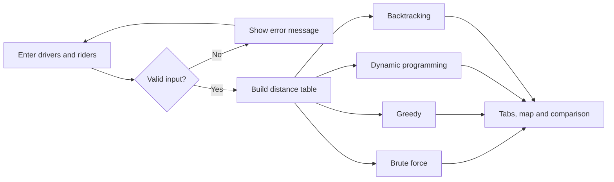

Every algorithm receives the same cost table `C[i][j]` (distance from driver *i* to rider *j*) and returns `{ match, ops }`, where `match[j]` is the driver given to rider *j* and `ops` is the number of steps counted.

## 📁 Project structure

```
algorithm-explorer/
├── index.html                  page layout: intro, form, tabs, results
├── css/
│   └── style.css               design system, colours, animations
├── js/
│   ├── main.js                 validation, UI, map drawing, animations
│   ├── bruteForce.js           brute force algorithm
│   ├── greedy.js               greedy algorithm
│   ├── dynamicProgramming.js   bitmask dynamic programming
│   └── backtracking.js         backtracking with pruning
├── assets/images/              logo, banner, favicon, screenshots
└── README.md
```

## 🚀 Run locally

No build step and nothing to install.

```bash
git clone https://github.com/YOUR-USERNAME/YOUR-REPO.git
cd YOUR-REPO
# open index.html in your browser, or serve it:
python3 -m http.server 8000      # then visit http://localhost:8000
```

## 🌐 Deployment

Hosted with **GitHub Pages**: repository *Settings → Pages → Deploy from a branch → main / root*.

## 👥 Team

| Name | Role | Algorithm explained in viva |
|---|---|---|
| _Member 1_ | _e.g. UI and design_ | _Brute force_ |
| _Member 2_ | _e.g. Form and validation_ | _Greedy_ |
| _Member 3_ | _e.g. Algorithms_ | _Dynamic programming_ |
| _Member 4_ | _e.g. Testing and docs_ | _Backtracking_ |

---

<div align="center">

Built as an Algorithm Explorer project · Brute force, greedy, dynamic programming and backtracking

</div>
